<div align="center">



</div>

<table width="100%">
<tr>
<td width="30%" valign="top" align="center">


`Suspect`

</td>
<td width="70%" valign="top">

```
════════════════════════════════════════════════════════════════
 DEVELOPER FILE -- STATUS: OPEN TO OPPORTUNITIES
 REGISTERED: NSUT DELHI          CLEARANCE: PORTFOLIO REVIEW
════════════════════════════════════════════════════════════════

 IDENTIFICATION:   NSUT / ICE-2027
 NAME:              SHIVANSH SHARMA
 TITLE:             FULL-STACK DEVELOPER / AI SYSTEMS
 COLLEGE:           NETAJI SUBHAS UNIVERSITY OF TECHNOLOGY
 DEGREE:            B.TECH, INSTRUMENTATION & CONTROL ENGINEERING
 GRADUATION:        2027
 STATUS:            ACTIVELY INTERVIEWING
 ─────────────────────────────────────────────────────────────
 LANGUAGES:  PYTHON . JAVA . JAVASCRIPT
 STACK:      FASTAPI . LANGGRAPH . NEXT.JS . NODE.JS . MONGODB . PINECONE
 ─────────────────────────────────────────────────────────────
 KEY PROJECTS ON FILE:
 A1.  ALFRED      -- AI AGENT PLATFORM
 A2.  DOCINTEL    -- HYBRID RAG PIPELINE
 A3.  HEX         -- REAL-TIME AI CHAT PLATFORM
 A4.  FOCUSNOTCH  -- WINDOWS FOCUS OVERLAY
 A5.  PDF PORTAL  -- [ONE-LINE DESCRIPTION]
 A6.  INSIGHTS    -- SOCIAL ANALYTICS DASHBOARD
════════════════════════════════════════════════════════════════
```

</td>
</tr>
</table>


## `> PROJECT FILES`

<!-- ============ ALFRED ============ -->
<table width="100%">
<tr>
<td width="15%" align="center">


</td>
<td width="85%">

### A1 · ALFRED — Personal AI Agent

**CLASSIFICATION:** Solo-built · Full-Stack · Deployed
**STACK:** FastAPI · LangGraph · Next.js · Pinecone · Zustand · Render + Vercel

- `MODEL_REGISTRY` architecture for unified routing across Gemini 2.5 Flash, Llama 3.3 70B, and Cerebras
- LLM Wiki memory system (inspired by Andrej Karpathy) with session-end summarizer and nightly relevancy decay pruning, cutting memory retrieval latency by 50%
- 2-layer token-efficient RAG: chat history queried before Pinecone, MarkItDown chunking improving retrieval accuracy by 30%
- Tavily web search, SSE streaming with abort, JWT auth with refresh tokens, Google OAuth

**LIVE:** [alfred-khaki.vercel.app](https://alfred-khaki.vercel.app)

</td>
</tr>
</table>


<!-- ============ DOCINTEL + HEX ============ -->
<table width="100%">
<tr>
<td width="50%" valign="top">

### A2 · DOCINTEL — Hybrid RAG Pipeline

**CLASSIFICATION:** Take-home build → HPC deployment
**STACK:** Docling · Pinecone · BM25 · Cohere Rerank

- Document parsing and chunking via Docling
- Dense (Pinecone) + sparse (BM25) retrieval merged with RRF
- Cohere Rerank for precision re-ranking
- Deployed and evaluated on client HPC infrastructure

</td>
<td width="50%" valign="top">

### A3 · HEX — AI Personality Chat

**CLASSIFICATION:** Full-stack real-time chat, 7 personas
**STACK:** Node.js · React.js · Socket.IO · Clerk · MongoDB

- Gemini streaming over Socket.IO WebSockets, cutting perceived response latency by 40%
- JWT auth via Clerk, chat history persisted in MongoDB
- Backend deployed on Render with concurrency optimization

</td>
</tr>
</table>


<!-- ============ FOCUSNOTCH + PDF PORTAL ============ -->
<table width="100%">
<tr>
<td width="50%" valign="top">

### A4 · FOCUSNOTCH — Focus Overlay

**CLASSIFICATION:** Desktop app · Windows
**STACK:** [FILL IN]

- Notch-style bar that sits at the top of the screen
- Active task, pomodoro timer, and to-do list
- Media controls and web shortcuts
- Screenshot organizer

</td>
<td width="50%" valign="top">

### A5 · PDF PORTAL — [Subtitle]

**CLASSIFICATION:** [FILL IN]
**STACK:** [FILL IN]

- [What it does]
- [Key feature or result]
- [Deployment or link]

</td>
</tr>
</table>


<!-- ============ INSIGHTS ============ -->
### A6 · INSIGHTS — Social Analytics Dashboard

**CLASSIFICATION:** In progress · Multi-platform SaaS
**STACK:** FastAPI · PostgreSQL · modular monolith with background workers

- One dashboard for creators and businesses, starting with YouTube, then Meta, LinkedIn, TikTok, and Google Analytics
- Multi-tenant accounts: individual or company, teams, and per-platform Read/Post roles
- Shared sign-in across separate tools, with rotating refresh-token auth


<div align="center">

[](https://github.com/Shivanshxsharma)
[](https://huggingface.co/shivansh012)

</div>
